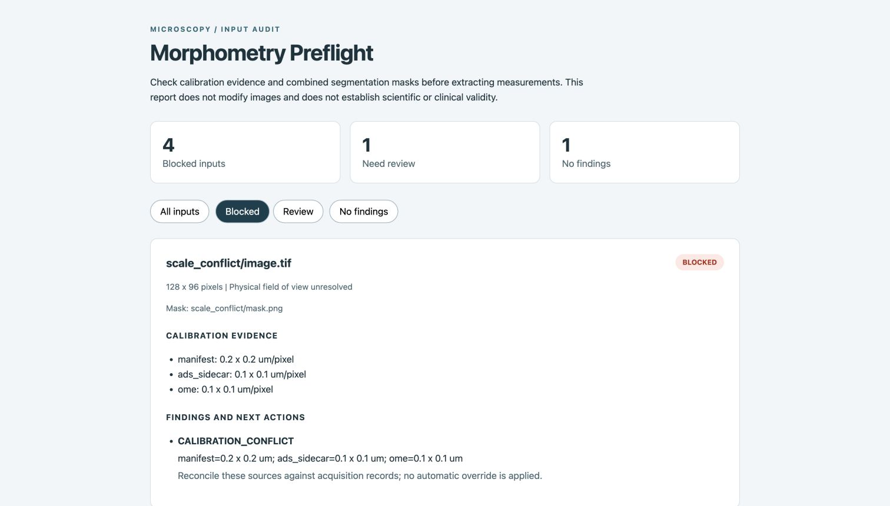

# Morphometry Preflight

Audit physical pixel calibration and combined axon/myelin masks before extracting measurements from 2D microscopy images.

This independent prototype focuses on a small, practical failure mode: an image, its mask and its calibration can each look reasonable while disagreeing with one another. It collects the evidence, reports conflicts, and leaves the inputs unchanged.

It is not affiliated with NeuroPoly or AxonDeepSeg. It has been tested on synthetic fixtures, not validated by a research laboratory.



[Example JSON results](examples/demo-report/audit.json) | [Design decisions](docs/design.md) | [Verification](docs/verification.md)

## Example

An OME-TIFF declares **100 nm/pixel**. Its folder's `pixel_size_in_micrometer.txt` declares **0.1 um/pixel**. Those values agree. But the batch manifest declares **0.2 um/pixel**. The tool blocks this input, records all three sources, and asks the operator to reconcile them against the acquisition record.

For the same pixel coordinates, using 0.2 instead of 0.1 doubles physical lengths and multiplies physical areas by four. This mathematical example does not identify which calibration is correct and does not model how segmentation itself might change.

## Why this scope

AxonDeepSeg already segments microscopy images, extracts morphometrics, provides QA features and supports manual correction. Reimplementing those features would add little value. This project instead explores a read-only batch check at the boundary between image exports, segmentation masks and physical calibration.

The checks run locally on existing images and masks. No model training or inference is involved.

## Install

Python 3.11 or newer:

```sh
git clone https://github.com/AymenBenalia/morphometry-preflight.git
cd morphometry-preflight
python -m venv .venv
source .venv/bin/activate
python -m pip install -e .
```

Dependencies are NumPy (pixel checks), pandas (tabular exports) and Pillow (PNG/TIFF decoding). Tests use Python's standard `unittest` library. No GPU, external service or AxonDeepSeg installation is required.

## Run the synthetic demo

```sh
python examples/make_demo.py examples/demo-data
morphometry-preflight examples/demo-data/manifest.csv --output examples/demo-report
```

The demo deliberately includes errors, so the audit exits with status **2**. Open `examples/demo-report/report.html` in a browser. The report works offline and includes filters by result status. JSON and CSV exports are written beside it.

Six fixtures exercise a consistent calibration, conflicting calibration, wrong mask dimensions, missing calibration, wrong label values, and an empty mask. The grayscale images are seeded random arrays with simple geometric masks, not microscopy acquisitions or model predictions.

## Audit your inputs

Create a UTF-8 CSV:

```csv
image,mask,pixel_size_um
sample-a/image.tif,sample-a/image_seg-axonmyelin.png,0.1
sample-b/image.png,sample-b/image_seg-axonmyelin.png,
```

Paths are relative to the CSV's directory. The `image` column is required; `mask` and `pixel_size_um` are optional. An omitted mask produces a review finding. Physical calibration must be available from at least one supported source. Unknown CSV columns are rejected to catch misspellings.

```sh
morphometry-preflight /path/to/dataset/manifest.csv --output /path/to/reports/run-01
```

The output folder must be outside the CSV's directory tree to prevent accidental writes to the dataset. Input paths and calibration sidecars cannot escape that directory through `..`, absolute paths or symlinks. Reports include filenames and may be sensitive even though image pixels and original OME XML are not embedded.

## Checks

- Actual PNG/TIFF decoding, grayscale mode, single-frame input, finite values and constant images.
- Physical calibration from the manifest, an ADS-style folder sidecar, and one 2D OME Image in TIFF metadata.
- Unit normalization for OME `nm`, `um`, `µm`, `μm`, `mm`, `cm` and `m`. Missing OME length units default to micrometers, following the OME schema.
- Cross-source calibration agreement and square-pixel checks, using a fixed 1% relative tolerance. This is an explicit engineering policy, not a scientifically established threshold.
- Image/mask dimensions and combined ADS mask values: 0 for background, 127 for myelin and 255 for axon. Empty masks and masks without axons require review.
- Duplicate image rows, source hashes, tool versions, findings and suggested next actions.

All sources are compared. No calibration source silently wins over a conflicting source. When sources agree within tolerance, the physical field of view uses the manifest X scale, otherwise OME X scale, otherwise the sidecar scale; the evidence and policy remain in JSON.

`no_findings` means that no implemented check found a problem. It does not prove the calibration, image quality, mask accuracy, spatial registration or biological interpretation is correct. An image and mask of the same dimensions can still be misaligned.

## Outputs and exit codes

- `report.html`: self-contained, offline report with evidence and actions.
- `audit.json`: structured results, SHA-256 hashes and environment versions.
- `audit.csv`: one row per input for downstream review. Formula-like filenames are escaped for spreadsheet use; original strings remain in JSON.
- Exit **0**: no findings; **1**: review findings; **2**: blocked input or invalid invocation.

Source files are never corrected or resized automatically. Existing reports in the chosen output directory are replaced. Report-file symlinks are rejected.

## Python API

```python
from pathlib import Path
from morphometry_preflight import audit_manifest

for result in audit_manifest(Path("dataset/manifest.csv")):
    print(result.image, result.status)
    for finding in result.findings:
        print(finding.code, finding.message, finding.action)
```

## Tests

```sh
python -m unittest discover -s tests -v
```

Tests cover planted scientific-input failures, unit conversion, malformed metadata, path containment, unchanged sources, offline HTML escaping, spreadsheet formula escaping, CLI exit codes and deterministic reports. A GitHub Actions workflow is included for Python 3.11, 3.12 and 3.13. The presence of that workflow does not mean it has run on GitHub.

## Limits and useful next steps

This release supports single-plane grayscale PNG/TIFF and a single combined mask per image. It does not support whole-slide images, multichannel images, z-stacks, multi-series OME-TIFF, DICOM, NIfTI, proprietary microscope formats, automatic scale-bar reading or spatial registration validation. TIFF/PNG display DPI is deliberately not treated as scientific calibration. The decode limit is 25 million pixels per file; increasing `--max-pixels` increases memory requirements.

The useful next validation would be a small, permission-cleared batch from an actual microscopy workflow, reviewed with a researcher. That would establish whether these findings catch recurring mistakes, which metadata are missing in practice, and whether the checks belong in an existing tool instead of a separate package. No claim of worldwide novelty or demonstrated research impact is made.

## Related tools and sources

- [AxonDeepSeg documentation](https://axondeepseg.readthedocs.io/en/latest/documentation.html): existing segmentation, masks and morphometrics workflow, including scalar pixel calibration and the folder sidecar.
- [NeuroPoly software](https://neuro.polymtl.ca/software.html): research-software context and invitation to contribute.
- [OME units documentation](https://omero.readthedocs.io/en/stable/developers/Model/Units.html): physical pixel sizes are quantities with length units.
- [Bio-Formats physical-size example](https://github.com/ome/bio-formats-examples/blob/master/src/main/java/ReadPhysicalSize.java): extracting and converting existing calibration metadata.
- [NGFF-Zarr TIFF support](https://ngff-zarr.readthedocs.io/en/latest/tiff.html): already provides OME metadata extraction and conversion. This prototype's focus is cross-source conflicts and paired ADS masks, not metadata reading itself.

## License

MIT. Synthetic example data generated by this project are distributed under the same license. Third-party names identify documented formats and workflows, not endorsement.
